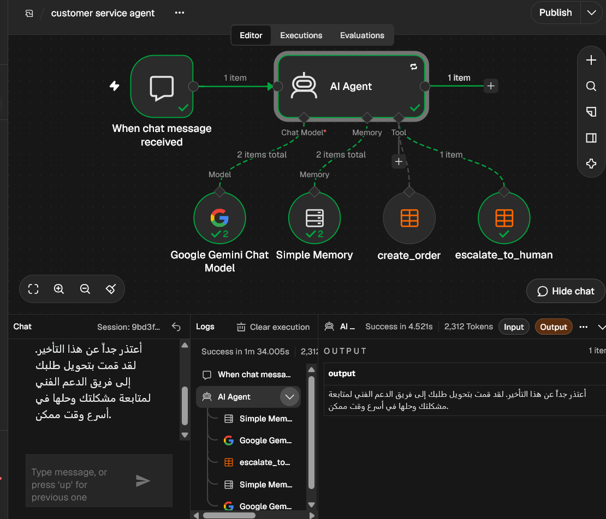
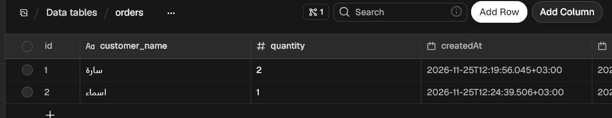
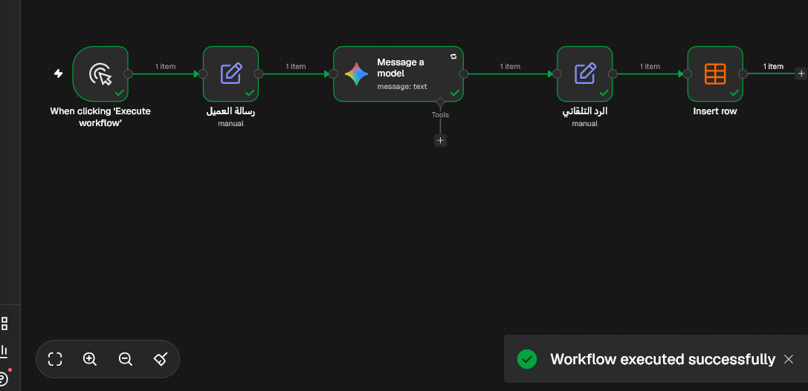

# ai-learning

A hands-on project where I learn to build AI-powered tools step by step: from a first API call, to a customer-message classifier, a RAG assistant, and finally an **AI customer-service agent** that takes real actions.

## Projects

### ⭐ 5. AI customer-service agent for an online store (`n8n/customer_service_agent.json`)
An Arabic-speaking AI agent for my Salla store ("صوتكِ الواثق"). It answers customers, remembers the conversation, and **decides by itself which tool to use**.

`Chat message → AI Agent (Gemini + Memory) → Tools: create_order / escalate_to_human`

- **create_order**: saves the customer's name and number of copies to an orders table. The agent fills the fields itself from the customer's message ("نسختين" → `2`)
- **escalate_to_human**: logs angry customers or payment problems to an escalations table, with a short summary of the reason
- If the name or quantity is missing, the agent **asks first** instead of guessing
- Answers only from the store information; instructions and temperature 0 stop it from inventing links or promises
- **Result: 5/5 test scenarios correct** (order, missing info, complaint, price question, greeting)
- Also built in Python with automatic function calling (`day5_agent.py`) to understand how tool selection works under the hood

### 4. RAG assistant (`day4_rag.py`)
Answers customer questions **only from the store's own information**.

- Splits the store info into chunks and turns them into embeddings (`gemini-embedding-001`)
- Finds the most relevant chunks with cosine similarity, then sends them to the model with the question
- Says "I don't have this information" instead of guessing
- **Result: 5/5 correct answers**

### 3. n8n automation (`n8n/customer_message_classifier.json`)
The message classifier as a no-code automation:

`Trigger → Customer message → Gemini (classify) → Prepare data → Save to table`

- Gemini node with system instructions, JSON output, temperature 0, and automatic retry
- Parses the model's JSON response and saves message, category and priority to an n8n data table
- **Result: 3/3 test messages classified correctly**

### 2. Customer message classifier (`day2_json.py`)
Classifies e-commerce customer messages into **inquiry / complaint / request / other** and sets a **priority**, returning structured JSON.

- Uses a JSON schema with fixed allowed values, so the model cannot invent new categories
- Temperature set to 0 for consistent results
- Includes a test set of 8 messages with expected answers, and calculates accuracy
- Retries automatically when the server is busy (503) and waits between requests to respect rate limits
- **Result: 8/8 correct** on `gemini-3.7-flash` and `gemini-3.1-flash-lite` (see `results.csv`)

### 1. First Gemini API call (`main.py`)
A Python script that sends a question to Google's Gemini model and prints the response, with the API key kept secure in a `.env` file.

## Tools
- Python 3.13
- Gemini API (Google AI Studio): text generation, embeddings, function calling
- google-genai, python-dotenv
- n8n (self-hosted, Node.js 24): AI Agent, Simple Memory, Data Table tools
- Git & GitHub

## How to run (Python)
1. Create and activate a virtual environment:
   `python -m venv venv` then `.\venv\Scripts\Activate.ps1`
2. Install the libraries:
   `pip install google-genai python-dotenv`
3. Create a `.env` file and add your own key:
   `GEMINI_API_KEY=your_key_here`
4. Run a script, for example:
   `python day4_rag.py`

## How to use the n8n workflows
1. Install n8n: `npm install -g n8n`, then run `n8n start`
2. Open `http://localhost:5678` and import a file from the `n8n/` folder
3. Add your own Gemini API key as a credential in n8n
4. For the agent: create two data tables, `orders` (customer_name, quantity) and `escalations` (reason)

## Files
- `main.py`: first call to the model
- `list_models.py`: lists the models available for your API key
- `day2_tokens.py`: token counting and temperature experiments
- `day2_prompt.py`: classification with system instructions
- `day2_json.py`: classifier with JSON schema, test set and accuracy
- `results.csv`: latest test results
- `store_info.txt`: store information used by the RAG assistant and the agent
- `day4_embeddings.py`, `day4_search.py`, `day4_rag.py`: embeddings, semantic search and RAG
- `day5_agent.py`: AI agent with tools in Python
- `n8n/`: exported n8n workflows and screenshots

## What I learned
- How to call an AI model (Gemini) from Python using an API
- How to keep API keys secret using a `.env` file and `.gitignore`
- How to connect a local project to GitHub and push it safely
- How to read error messages (4xx = my mistake, 5xx = server issue, 429 = quota used up)
- How to list the available models for my API key and choose the right one
- Clear instructions turn a long chat answer into a short, usable result
- One clear rule works better than a long page of vague instructions
- Changing one rule can break results that seemed unrelated, so I re-run the full test after every change
- Low temperature plus clear rules gives consistent classification
- How to build an automation in n8n and pass JSON data between steps
- Embeddings and RAG: good data matters more than more code
- The difference between a chatbot and an agent: a chatbot *says* "I've registered your order", an agent actually *does* it
- A tool's name and description guide the agent on when and how to use it
- Every tool call costs an extra model request, so an agent should only get the tools it needs
- Models can invent links or promises (hallucination), so I test every answer against the real store data
